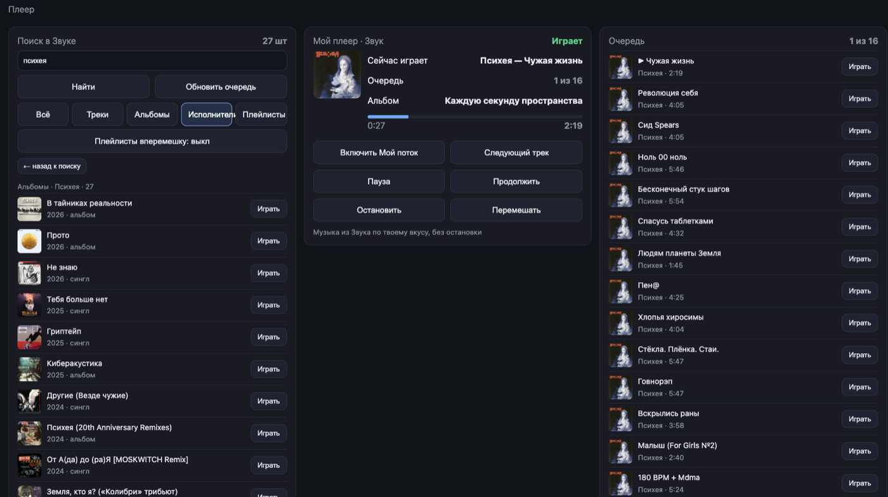

# zvukd — плеер «Звука» для Яндекс Станции

Демон без экрана: играет музыку из «Звука» на колонке с root. Управление — командой,
локальным сокетом, голосом и веб-панелью. Один статический бинарник под aarch64/musl,
без интерпретатора и без библиотек прошивки.

Проверено на Станции 2 (платформа `yandexmidi`, прошивка `0.369.1.50`, ядро `aarch64`,
userspace 64-бит). На других моделях не проверялся.

## Быстрый старт

Нужен root и SSH на колонке — это единственная сложная часть, автоматизировать её нельзя
(подмена DNS, прокси с сертификатом, окно ADB). Дальше всё делает один скрипт:

```sh
git clone https://github.com/derangedabbot/zvuk-yandex-station-player.git
cd zvuk-yandex-station-player
sh scripts/build.sh                       # или взять готовый dist/zvukd из репозитория
./scripts/install.sh 192.168.1.50         # токен спросит
```

Установщик сам: проверит, что SSH отвечает и что мы root; разложит бинарник и обёртку
в `/data/local`; запишет токен с правами `600`; поставит автозапуск отдельным файлом
`/etc/init.d/S96zvukd` (чужие init-скрипты не правит); запустит демон и проверит, что он
отвечает `pong`. Повторный запуск — обновление, ничего не ломает.

Полезные варианты:

```sh
./scripts/install.sh <IP> --check         # только показать состояние, ничего не менять
./scripts/install.sh <IP> --with-voice    # плюс голосовые команды («Алиса, дальше»)
./scripts/install.sh <IP> --token <T>     # токен аргументом, без вопроса
./scripts/install.sh <IP> --key ~/.ssh/station_key --port 2222
```

Если токена ещё нет: он берётся из веб-сессии «Звука» (32 символа), кладётся на колонку
в `/data/local/etc/zvuk.token` и никуда больше не попадает. `device_id` спрашивать не нужно —
плеер читает его из `/data/quasar/devices.json` сам.

После установки: в приложении «Дом с Алисой» выберите подсветку **«выключено»** (иначе
штатная анимация затрёт наше кольцо), и можно говорить «Алиса, включи звук».

`scp` на прошивке нет (нет sftp-server), поэтому файлы передаются через
`cat файл | ssh 'cat > путь'`.

## Что умеет

| Возможность | Как это выглядит |
|---|---|
| «Мой поток» Звука | играет пачками и сам догружает следующие |
| поиск | четыре группы: треки, альбомы, исполнители, плейлисты |
| альбом и исполнитель | все треки альбома или популярные треки исполнителя в очередь |
| альбомы исполнителя | список всех релизов группы с годом и обложкой |
| плейлисты | грузятся страницами по 100 и догружаются сами; есть режим «вперемешку» |
| очередь | переход по любому треку, перемешивание, сохранение и «Продолжить последнее» |
| очередь пополняется | «+» у трека, у целого альбома и у исполнителя (его популярные треки) — всё в конец |
| очистка очереди | одна кнопка: очередь пустеет, играющий трек остаётся и играет дальше |
| предзагрузка | следующий трек качается заранее — переключение без паузы |
| обложка и прогресс | в панели: картинка, время, полоса, альбом текущего трека |
| уступает звук Алисе | пока она говорит — пауза, после — с того же места; если она вернула свой поток, наш трек возвращается один раз (не чаще раза в 30 с) |
| свет | своё зелёное дыхание кольца (и состояния Алисы зелёным), см. раздел «Подсветка кольца» |
| голос | пять фраз: «включи звук», «пауза», «продолжи», «дальше», «стоп» |
| FLAC | играет **её собственный плеер** (декодирует сам, локальный `flac` не нужен); по умолчанию берём `high` (mp3) |
| автозапуск | отдельный `/etc/init.d/S96zvukd` (ставится `scripts/install.sh`) |

## Команды

```text
zvukd                          # демон, слушает /run/zvukd.sock
zvukd flow                     # «Мой поток»: играет и догружает пачки
zvukd play "кино группа крови" # первый найденный трек
zvukd next | prev | pause | resume | stop
zvukd status                   # play|pause|idle|<трек>|<pid>|<обложка>|<номер>|<всего>|…
```

Поиск и выбор:

```text
zvukd search "психея"          # JSON: треки, альбомы, исполнители, плейлисты
zvukd play-id 85248905         # выбранный трек; остальные треки поиска — в очередь
zvukd play-album 4146607       # весь альбом
zvukd play-artist 186139       # популярные треки исполнителя
zvukd artist-albums 3235588    # все релизы исполнителя (до 500; по умолчанию сервер отдаёт 50 свежих)
zvukd artist-tracks 3235588    # популярные треки исполнителя (JSON, для панели)
zvukd album-tracks 52865964    # треки альбома (для панели)
```

Плейлисты и очередь:

```text
zvukd play-playlist 123456            # первая сотня, дальше догружается сама
zvukd play-playlist-shuffled 123456   # со случайного места, страницы вразброс
zvukd queue                           # JSON: очередь и номер текущего
zvukd jump 5                          # перейти на 5-й трек очереди (очередь не пересобирается)
zvukd queue-add 85248905              # добавить трек в конец очереди
zvukd queue-add-album 4146607         # добавить весь альбом
zvukd queue-add-artist 186139         # добавить популярные треки исполнителя
zvukd queue-del 3                     # убрать 3-й трек из очереди
zvukd queue-clear                     # очистить очередь (играющий трек остаётся)
zvukd shuffle                         # перемешать очередь после текущего трека
zvukd resume-last                     # продолжить сохранённую очередь с её позиции
```

Служебное (диагностика): `states` — состояния Алисы, `duck-test` — уступить звук на три
секунды и продолжить без её участия, `listen` — кадры её канала, `hush` — попытка отменить её
ответ, `queue-tail` — проверка догрузки страниц плейлиста.

Ответ сокета — одна строка, ошибки начинаются с `ERR `. Протокол нарочно простой: его
одинаково удобно читать из `sh`, из панели и из слушателя голоса.

## Веб-панель

`http://<IP-КОЛОНКИ>:8081`, только домашняя сеть, без пароля — так задумано: защита в том,
что панель не выходит за пределы подсети.



Слева — поиск и найденные альбомы, в центре — что играет сейчас с прогрессом и альбомом,
справа — очередь с кнопкой «Играть» у каждой строки. Управление сверху не отнимает место
у музыки: панель открывается с телефона и с ноутбука одинаково.

- **Сверху системное:** что звучит, нагрузка, память, диски, сеть, прошивка.
- **Ниже «Плеер»:** строка поиска с вкладками «Всё / Треки / Альбомы / Исполнители /
  Плейлисты» и переключателем «Плейлисты вперемешку»; текущий трек с обложкой, прогрессом и
  названием альбома (альбом открывается списком треков); очередь с кнопкой «Играть» у каждой
  строки; кнопки потока, следующего трека, паузы, перемешивания и «Продолжить последнее».
- У исполнителя в результатах две кнопки: «Играть» (популярные треки) и «Альбомы» — все
  релизы группы с годом и типом.

### Как это работает

Обработчик — обычный `sh` под `socat` (в busybox этой прошивки нет `httpd`): `socat` слушает
порт и на каждое соединение запускает скрипт, тот читает строку запроса и отвечает.

| Маршрут | Что отдаёт |
|---|---|
| `/` | страница целиком (HTML + JS внутри, без внешних файлов) |
| `/api/status` | JSON: плеер, процессы, память, диски, сеть, прошивка |
| `/api/search?q64=<base64>` | треки, альбомы, исполнители, плейлисты |
| `/api/queue` | очередь и номер текущего трека |
| `/api/artist-albums?id=`, `/api/album-tracks?id=` | релизы исполнителя, треки альбома |
| `/action?do=zvuk-…` | действия: поток, дальше, пауза, продолжить, стоп, перемешать… |

Три вещи, без которых панель «висит»:

- **`socat -t 10`.** По умолчанию у него полсекунды на обмен, а `/api/status` собирается дольше —
  соединение рвалось, и панель получала пустой ответ (кнопки выглядели мёртвыми).
- **Владельца звука берём из `owner_pid`**, а не перебором всех процессов: перебор занимал 4 с.
  Сейчас холодный статус ~0.8 с, из кэша ~0.1 с.
- **Кэш статуса** на 3 секунды: панель опрашивает его часто, а процессор слабый.

### Поиск

Запрос уходит в `/api/search` **в base64** (`btoa(unescape(encodeURIComponent(q)))`): иначе
кириллица ломается в адресной строке. Ответ разбирается на четыре группы — треки, альбомы,
исполнители, плейлисты; вкладки сверху переключают показ.

- У трека кнопка «Играть» ставит его и кладёт **весь список найденного** в очередь.
- У исполнителя две кнопки: «Играть» (популярные треки) и «Альбомы» — релизы с годом и типом.
- У альбома кнопка открывает список треков, у плейлиста — играет его (в том числе вперемешку:
  тогда страницы догружаются вразброс).
- Обложки грузятся прямо с `cdn-image.zvuk.com` — токен им не нужен. Исключение — плейлисты:
  у них относительный путь на `zvuk.com`, который на внешний запрос не отдаётся, поэтому у них
  плитка пустая (лучше, чем битая картинка).

## Голосовые команды

Алиса отдаёт **готовый текст распознавания** в локальный канал `127.0.0.1:9875`
(кадр = 4 байта длины + protobuf; поле `253=3` — состояние, внутри `252`: `1=3` финальное,
`2` — текст). Слушатель читает этот поток и превращает фразы в команды плеера.

| Говоришь | Что происходит |
|---|---|
| «включи звук», «включи мой плеер» | «Мой поток»: играет и догружает пачки |
| «пауза» | пауза, секунда запоминается |
| «продолжи» | тот же трек с того же места |
| «дальше», «следующий» | следующий трек из очереди |
| «стоп», «выключи музыку» | полная остановка |

Сравнение идёт по подстроке и **без первой буквы** («ключи звук», «ауза»): Алиса отдаёт
«Включи звук» с большой буквы, и шаблон с заглавной не совпадал. Одно распознавание приходит
несколькими кадрами, поэтому есть защита от повтора: та же фраза в течение 5 секунд игнорируется.

### Почему это работало не сразу

Три проблемы, каждая проверена на живой колонке:

1. **Её облако отвечает позже нас.** На «продолжи»/«дальше» Алиса сама запускает свой поток —
   замер по `mediad.log`: её поток появляется через 0.3 с после команды. Если наш трек поставить
   сразу, его затирает её поток и играет Алиса. Поэтому локальная команда выжидает **1.5 с** и
   ставится последней — выигрывает тот, кто отправил позже.
2. **Нельзя трогать звук, пока она слушает.** Возврат музыки — это `stop` + `audio_play`, то есть
   команды ровно в момент её диалога: она активируется и сразу гаснет. Музыка возвращается
   только когда она закончила (состояние `0`), на «слушает» (`1`) мы молчим.
3. **Пауза — только вместе с потоком.** Отдельная команда `pause` её плеером игнорируется
   (звук продолжается), а наш счётчик встаёт — легко обмануться. Работает так:
   `audio_play` + `"set_pause": true` в одной посылке.

Отдельно стоит знать, чего мы **не** стали делать: автоматически «угадывать» подмену трека по
названию, длительности или позиции. Все три попытки кончились плохо — либо её волна играла
несколько секунд, либо трек уходил в бесконечные перезапуски (звук как будто испорченный).
Порядок команд оказался надёжнее любой эвристики.

## Как устроено

**Звук — её собственным плеером.** Демон не борется за ALSA: он поднимает свой HTTP-раздатчик
на `8765`, скачивает трек из «Звука» и отдаёт станции ссылку `http://127.0.0.1:8765/<файл>`
командой `audio_play` (protobuf `{1:"audio_play", 2:{"stream":{…},"set_pause":false}}`).
Играет штатный `maind --mediad`, поэтому Алиса остаётся живой, а громкость, пауза и мультирум
работают как обычно. Раздатчик обязан поддерживать `Range` (`206` + `Content-Range`): без этого
продолжение с позиции начинается с нуля.

## С AirPlay: одно устройство на двоих

Если на колонке поднят AirPlay-приёмник (`shairport-sync`), он и наш плеер претендуют на одно
и то же звуковое устройство: кто первый встал, тот и играет, второй молчит — а выглядит это как
«звук пропал».

Договорились так: демон раз в 0.7 с смотрит, есть ли **установленное соединение на порту 7000**
(это и есть живая AirPlay-сессия). Есть — ставим наш трек на паузу и не мешаем. Сессия
закончилась — продолжаем с той же секунды сами, без команд.

Важно: пауза именно наша (`set_pause`), поэтому позиция сохраняется; после AirPlay музыка
вернётся туда же, где остановилась. Отличить «пауза из-за AirPlay» от паузы, которую поставил
человек, помогает отдельный флаг — снимаем только свою.

Одной паузы мало: устройство всё равно держит штатный медиа-демон станции (`maind --mediad`),
и приёмник получает `EBUSY` — AirPlay «подключён», а звук не идёт. Поэтому на стороне колонки
нужен распорядитель звука из [репозитория про станцию](https://github.com/derangedabbot/yandex-station-midi-airplay)
(`scripts/device/audio-owner.sh`): он гасит `mediad` на время сессии и поднимает обратно после.
Главная ловушка: признаком «AirPlay играет» должен быть **сокет на 7000**, а не владение ALSA —
устройством владеет `mediad`, и признак «приёмник уже держит» всегда ложный.

## Подсветка кольца

Кольцо на Станции 2 — это не `/sys/class/leds`, а кадровый буфер: **`/dev/fb0`**, 89 пикселей
по 4 байта (`R,G,B,X`), то есть 356 байт на кадр. Держит его `maind --platformd`, и пока он
что-то рисует, любой наш кадр будет затёрт.

**Почему не перекраска паттернов.** В прошивке лежат 45 готовых анимаций
(`/system/vendor/quasar/ledpatterns/panel/*.led`, текстовый формат: кадр = строка, светодиод =
8 hex-цифр). Мы их перекрасили в зелёный, перезагрузились — на экране ничего не изменилось.
Проверка по геометрии (какие пиксели светятся) не совпала ни с одним файлом ни в одном кадре:
анимация при музыке **считается на лету**, в `maind` для этого есть `COLOR_SCENE`,
`SetHueDirectiveType` и hue/saturation. Подмена файлов бесполезна, а локальные команды
`setColorScene`/`setHue` принимаются с ответом `SUCCESS`, но на кольцо не влияют.

**Как сделано.** В приложении «Дом с Алисой» подсветка ставится в **«выключено»** — тогда
`maind` в буфер не пишет, и демон рисует кольцо сам, 12 раз в секунду:

| Что происходит | Что на кольце | Яркость зелёного |
|---|---|---|
| играет музыка (наша или её поток) | медленное дыхание, период ~12 с | 20…110 |
| Алиса слушает | ровно | 190 |
| Алиса говорит | быстрый пульс (~1.1 Гц) | 150…195 |
| Алиса занята (думает) | ровно | 100 |
| пауза, стоп, тишина | погашено | 0 |

Все состояния — **только зелёный канал**, красный и синий всегда нули. Источник «что играет» —
состояние самой станции, поэтому её собственный поток тоже даёт дыхание (цветомузыки при этом
нет вообще — она отключена вместе со штатной подсветкой).

**Чтобы два художника не дрались.** Раз в ~5 секунд демон делает проверку: два чтения буфера
подряд, **не записывая между ними**. Если содержимое изменилось само — значит рисует `maind`
(включили штатную подсветку или Алиса показывает своё) — демон уступает на 12 секунд и молчит.
Сравнивать «что записали» с «что прочитали» нельзя: после гамма-коррекции значения не совпадают,
на этом первая версия глушила сама себя.

Крутить под себя: яркость и период дыхания — в `led_level()` в `src/player.rs` (там же уровни
для состояний Алисы), частота кадров — `sleep(...from_millis(80))` в задаче отрисовки.

**Старый путь (ALSA) остался** для отката: `ZVUK_MODE=alsa` — тогда `mpg123` отдаёт raw PCM на
stdout, а в усилитель пишет `aplay`; пауза — `SIGSTOP` обоим процессам. Подробнее о граблях —
[`docs/playback.md`](docs/playback.md).

**Кэш — в оперативной памяти.** Трек качается в `/tmp/zvukd` (tmpfs, 245 МБ при 500 МБ ОЗУ),
путь переопределяется `ZVUKD_CACHE`. Держатся два файла — текущий и предзагруженный, остальные
удаляются; потолок одного файла 80 МБ. Причина: `/data` всего 199 МБ и у флеша ограниченное
число перезаписей, а трек нужен один раз.

**Предзагрузка.** После старта трека демон сразу качает следующий из очереди, поэтому
переключение происходит без паузы.

**Сохранение.** Очередь, номер текущего трека и позиция пишутся в
`/data/local/etc/zvukd.state.json` при каждом переходе. После перезапуска демон поднимает
очередь, но не начинает играть сам — в панели появляется «Продолжить последнее».

**Уступка звука Алисе.** Устройство воспроизведения одно и без микшера: пока играем мы, её
голос не звучит. Демон слушает её состояние в локальном канале `127.0.0.1:9875` (кадры
`253=3`, поле 1: 0 молчит, 1 слушает, 2 говорит, 3 занята). На «говорит» воспроизведение
останавливается и запоминается позиция, на «молчит/слушает» тот же трек продолжается с того же
места через `mpg123 -k <кадры>` (кадр MP3 при 44,1 кГц — 1152 сэмпла, ≈38,28 кадра в секунду).
Пауза через `SIGSTOP` для этого не годится: устройство остаётся занятым.

**Своё слово-активатор.** На этой прошивке невозможно: настоящий микрофон (`hw:0,2`)
монопольно держит `maind --platformd`, свободные устройства записи отдают цифровую тишину, а
потока микрофона в локальном канале нет (в отличие от Станции Мини 2). Что проверено и где
именно упирается — в [`voice/README.md`](voice/README.md).

## Настройки

| Переменная | По умолчанию | Что задаёт |
|---|---|---|
| `ZVUKD_SOCK` | `/run/zvukd.sock` | сокет управления |
| `ZVUKD_CACHE` | `/tmp/zvukd` | где лежит скачанный трек |
| `ZVUK_TOKEN_FILE` | `/data/local/etc/zvuk.token` | файл токена |
| `ZVUK_WAVE_COUNT` | `10` | сколько треков брать в пачке потока |
| `ZVUK_MPG123` | `/data/local/opt/airplay/bin/mpg123` | декодер |
| `ZVUK_APLAY` | `/usr/bin/aplay` | вывод в ALSA |
| `ZVUK_RATE` | `44100` | частота вывода |
| `ZVUK_LOADER` | `/data/local/opt/tools/lib/ld-musl-aarch64.so.1` | загрузчик для musl-бинарников набора |

Сохранённая очередь лежит в `/data/local/etc/zvukd.state.json` (путь фиксированный).

## Ограничения

- **FLAC — только её плеером:** отдельного декодера на колонке нет, но `audio_play` отдаёт файл
  штатному `maind`, а он FLAC декодирует сам. `flacdrm` (с защитой) не играется в принципе.
  По умолчанию поток берём `high` — mp3 ≈320 kbps: разницы на этом усилителе не слышно,
  а качать и греть процессор зря не нужно.
- **Звук один:** одновременно с музыкой Алисы играть нельзя — отсюда уступка и забор устройства.
- **Голос — пять фраз**, и её собственное намерение тоже срабатывает: «включи …» она понимает
  как поиск музыки, поэтому фразы выбраны так, чтобы её поиск ничего не находил, а на
  «продолжи»/«дальше» наш трек ставится через 1.5 с — после её ответа.
- **Плейлист — страницами по 100:** точного числа треков API не отдаёт, поэтому «вперемешку»
  идёт случайными страницами, а не идеально ровно по всему списку.
- **Токен — веб-сессия:** смена пароля его убивает.
- Ссылки на поток протухают — резолвим перед каждым треком.
- Anti-bot Звука требует `Referer`, `Origin` и обычный `User-Agent` (уже в клиенте).

## Файлы

| Что | Где |
|---|---|
| Спецификация API Звука | [`docs/api.md`](docs/api.md) |
| Установка и где лежит трек | [`docs/install.md`](docs/install.md) |
| Стыковка с AirPlay, Алисой, панелью | [`docs/integration.md`](docs/integration.md) |
| GraphQL-запросы | [`queries/`](queries) |
| Клиент API (поиск, группы, страницы) | [`src/api.rs`](src/api.rs) |
| Воспроизведение, кэш, уступка звука | [`src/player.rs`](src/player.rs) |
| Демон, сокет, очередь, свет | [`src/main.rs`](src/main.rs) |
| Канал её состояний | [`src/alice.rs`](src/alice.rs) |
| Сборка | [`Dockerfile`](Dockerfile), [`scripts/build.sh`](scripts/build.sh) |
| Установка на колонку | [`scripts/install.sh`](scripts/install.sh) |
| Обработчик веб-панели | [`scripts/panel-handler.sh`](scripts/panel-handler.sh) |
| Неудавшиеся голосовые опыты | [`voice/`](voice) |

## Благодарности

Ничего из этого не появилось бы без чужих разборов. По источникам:

| Проект | Что из него взято |
|---|---|
| [v3rt3p/quasar-server](https://github.com/v3rt3p/quasar-server) | **Идея и схемы** локального управления: эмулятор её облака показывает, что колонка ждёт от сервера, какие возможности объявляет (`audio_client`, `audio_bitrate320`) и как выглядит protobuf команд. Через него нашлись `audio_play` и `externalCommandBypass` — без них плеер вообще не смог бы отдавать станции свой файл |
| [klockky/spotiya](https://github.com/klockky/spotiya) | локальный канал Алисы `127.0.0.1:9875` и мысль уступать ей звук |
| [hu553in/yandex-station-chatgpt-voice](https://github.com/hu553in/yandex-station-chatgpt-voice) | попытка своего слова-активатора (на этой прошивке не пошла — см. [`voice/README.md`](voice/README.md)) |
| [trudenboy/zvuk-music](https://github.com/trudenboy/zvuk-music) | рабочий Python-клиент «Звука»: тексты GraphQL-запросов сверены с ним |
| [korenskoy/zvuk-swift](https://github.com/korenskoy/zvuk-swift) | разбор «персональной волны» (`getPersonalWave`) |
| [hu553in/yandex-station-root](https://github.com/hu553in/yandex-station-root) | способ получить root через подмену облачного конфига |

Схема платежа за это — только упоминание: код у нас свой, но идеи и форматы данных чужие.

## Лицензия

MIT — см. [LICENSE](LICENSE). `mpg123` и `aplay` — сторонние программы, в репозиторий не входят.
